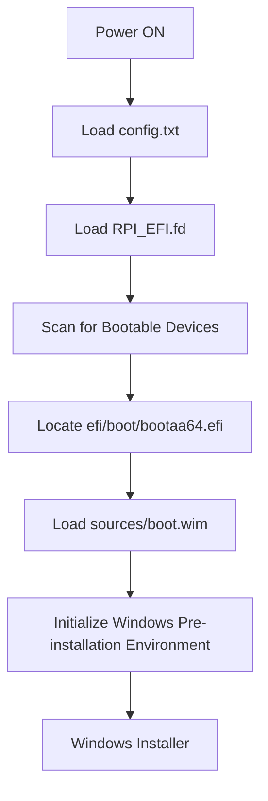

# Windows 11 on Raspberry Pi 5 Model B
A step-by-step guide to installing Windows 11 (ARM64) on a Raspberry Pi 5 Model B.

## Prerequisites
- Raspberry Pi 5 Model B with keyboard, mouse, and display connected.
- A USB drive with at least 8GB of capacity.
- Download **RPi5_UEFI_Release_v0.3.zip** and Extract the Raspberry Pi 5 firmware files from [rpi5-uefi GitHub Page](https://github.com/worproject/rpi5-uefi/releases)
- A valid Windows 11 ARM64 ISO file.
- An additional disk (external SSD/USB) to install Windows 11.

## Prepare a Bootable Drive
1. Erase/Format the drive
```bash
sudo dd if=/dev/zero of=/dev/sdX bs=1M status=progress
```

2. Create a partition table as GPT
  - Open gparted
  ```bash
  sudo gparted /dev/sdX
  ```
  - Go to the Device menu at the top and select Create Partition Table.
  - Choose **GPT** as the partition table type.
  - Click **Apply** or **OK**.

3. Create partitions
  - **Partition 1**: Create a **FAT32** partition of 1GB.
  - **Partition 2**: Create an **exFAT** partition using the remaining space on the drive.

4. Create directories for mounting the partitions:
```bash
sudo mkdir -p /media/boot
sudo mkdir -p /media/windows
```

5. Mount the partitions to the created directories:
```bash
sudo mount /dev/sdX1 /media/boot
sudo mount /dev/sdX2 /media/windows
```

> Note: Replace `/dev/sdX1` and `/dev/sdX2` with the appropriate partition identifiers for your USB drive.

6. Copy Raspberry Pi 5 Firmware Files:
```bash
sudo cp -r ~/RPi5_UEFI_Release_v0.3/* /media/boot/
```

7. Mount the Windows 11 ISO: **Double click** on ISO file
> Note: This will create temporary foldar similar to `/media/chandana/CPBA_A64FRE_EN-US_DV9`

8. Copy Boot Files to **Partition 1** from the mounted ISO directory:
```bash
sudo cp -r /media/chandana/CPBA_A64FRE_EN-US_DV9/boot/ /media/boot/
sudo cp -r /media/chandana/CPBA_A64FRE_EN-US_DV9/efi/ /media/boot/
```

9. Create a `sources` directory on boot partition (**Partition 1**) and copy `boot.wim`
```bash
cd /media/boot/
sudo mkdir sources
cd sources/
sudo cp /media/chandana/CPBA_A64FRE_EN-US_DV9/sources/boot.wim ./
```

10. Copy `install.wim` to **Partition 2**
```bash
cd /media/windows
sudo cp /media/chandana/CPBA_A64FRE_EN-US_DV9/sources/install.wim .
```

11. Umount the ISO

12. Umount the drive partitions
```bash
sudo umount /media/boot
sudo umount /media/windows
```

Files on **Partition 1** should be as follows:
- bcm2712-rpi-5-b.dtb
- boot/
- config.txt
- efi/
- RPI_EFI.fd
- sources/

Files on **Partition 2** should be as follows:
- install.wim

## Installation of Windows 11 on Raspberry Pi 5 Model B
**1. Insert the Installation Media** (Bootable Drive created in section [Prepare a Bootable Drive](#prepare-a-bootable-drive))
  - Insert the USB drive (installation media) into the Raspberry Pi (**D:** and **E:** are the **boot** and **`install.wim`** partitions of installation media respectively).
  - Connect the target disk (where Windows 11 needs to be installed).

**2. Power ON the Raspberry Pi:** Turn on the Raspberry Pi and ensure it boots from the installation media.

**3. Wait for Pre-Installation page**
  - The system should boot into the Windows 11 Setup screen.
  - You may encounter the **"Install driver to show hardware"** message.

**4. Open Command Prompt:** Press `Shift + F10` to open a command prompt.

**5. Use **DiskPart** to Prepare the Target Disk**
  - Launch **DiskPart** by typing `diskpart`
    ```bash
    X:\sources>diskpart
    ```
  - Select the drive on which windows has to be installaed and erase any previous data
    ```bash
    DISKPART> list disk
    DISKPART> select disk 0
    DISKPART> clean
    ```
  - Convert the Disk to GPT
    ```bash
    DISKPART> select disk 0
    DISKPART> conv gpt
    ```
  - Use `list partition` command to list all the partitions in the current disk (we will assume disk has no partitions, hence create from scratch).
  - Create a boot partition of **`500MB`** and assign a letter **`A:`** to it
    ```bash
    DISKPART> create partition efi size=500
    DISKPART> format fs=fat32 quick
    DISKPART> assign letter A
    ```
  - Create a primary OS partition, which will use the rest of the available disk space. and assign a letter **`C:`** to it
    ```bash
    DISKPART> create partition primary
    DISKPART> format quick
    DISKPART> assign letter C
    ```
  - Exit from the diskpart
    ```bash
    DISKPART> exit
    ```
    
6. Copy the firmware files into boot partition (**`A:\`**) from the installation media
```bash
X:\sources>copy D:\bcm2712-rpi-5-b.dtb A:\
X:\sources>copy D:\config.txt A:\
X:\sources>copy D:\RPI_EFI.fd A:\
```

> Note: **`D:\`** is the Boot partition of installation media where the raspberry pi firmware files are present

7. Apply the install.wim into Windows partition (**`C:\`**)
  - Get the Image info
    ```bash
    X:\sources>dism /Get-ImageInfo /ImageFile:E:\install.wim
    ```
    > Note: Select Index 2 (Windows 11 Pro)
  - Apply the install.wim
    ```bash
    X:\sources>dism /Apply-Image /ImageFile:E:\install.wim /Index:2 /ApplyDir:C:
    ```
  - Generate the Boot files
    ```bash
    X:\sources>bcdboot C:\Windows /s A: /f UEFI
    ```

8. Reboot the system and remove the installation media.
9. Bypass the network requirements  
When you region setup screen, remove the network cable and proceed to enable the bypass.
- Press `Shift + F10` on your keyboard to open the Command Prompt (click on the cmd prompt window to type something).
- Type `OOBE\BypassNRO.cmd` and press **Enter**.

> The system will restart, and after rebooting, Windows OOBE will include an option to bypass network setup.

11. Continue to setup the region and keyboard layout and then, select **I Don’t Have Internet**.
12. Complete the Setup
- Continue with the remaining installation steps to finish setting up Windows without requiring a Microsoft account.

## Start up Sequence for Installation Media

